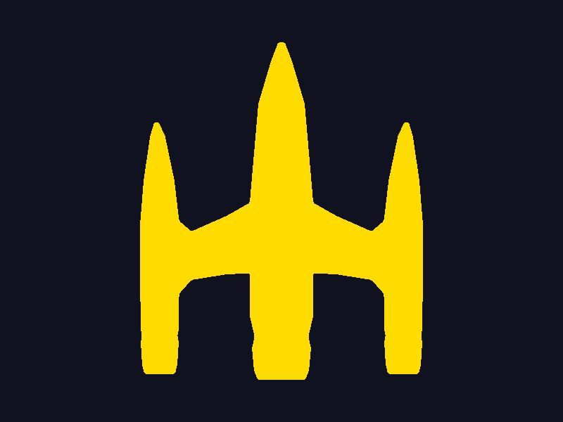

# Lab 4: cargar y dibujar la nave OBJ

## Objetivo

Cargar el modelo OBJ creado en el laboratorio anterior y dibujarlo en la pantalla
con la función propia para pintar triángulos. Recorrer las caras del archivo,
leer sus índices y obtener los tres vértices de cada triángulo. No sustituir este
recorrido por un motor 3D o una función que renderice el modelo completo.

## Archivos disponibles y dónde encontrarlos

Este repositorio (`lab4-graficas`) actualmente solo tiene su README y esta guía;
todavía hay que implementar el programa y traer las herramientas de dibujo de
los laboratorios anteriores.

El modelo que debe utilizarse está en:

```text
../lab3-graficas/entrega_sin_materiales/nave.obj
```

Ruta absoluta en este equipo:

```text
/home/deiv/Universidad/graficas/lab3-graficas/entrega_sin_materiales/nave.obj
```

Archivos de referencia del laboratorio anterior:

- [OBJ para cargar](../lab3-graficas/entrega_sin_materiales/nave.obj).
- [Modelo editable de Blender](../lab3-graficas/entrega_sin_materiales/nave.blend).
- [Captura de la geometría](../lab3-graficas/entrega_sin_materiales/captura_discord.png).
- [Verificación del OBJ](../lab3-graficas/entrega_sin_materiales/verificacion.json).

El OBJ tiene **734 vértices y 1464 triángulos**, una sola malla conectada y ningún
material ni textura. No requiere un archivo `.mtl`. No usar las versiones de
`lab3-graficas/output/`: corresponden a la nave detallada, no a esta entrega simple.

Para que el proyecto se pueda ejecutar sin tener el repositorio del laboratorio 3,
copiar el modelo a este repositorio. Desde la raíz de `lab4-graficas`:

```bash
mkdir -p assets
cp ../lab3-graficas/entrega_sin_materiales/nave.obj assets/nave.obj
```

Incluir `assets/nave.obj` en Git. La ruta de carga `assets/nave.obj` presupone que
el ejecutable se lanza desde la raíz del repositorio; documentar esa convención o
resolver la ruta de recursos explícitamente.

## Trabajo que falta implementar

### 1. Preparar el programa

- Recuperar las herramientas propias de `Color`, framebuffer y rasterización de
  triángulos desarrolladas anteriormente. Los nombres del enunciado son `color.h`,
  `framebuffer.h` y `triangle.h`; adaptar los includes a los archivos reales.
- Configurar C++ con SDL2 y GLM, incluyendo las instrucciones de compilación en el
  README. El enunciado usa SDL2 para la ventana y para presentar el framebuffer.
- Implementar o adaptar `init()`, `setColor()`, `clear()`, `renderBuffer()` y el
  bucle de eventos. En el esqueleto proporcionado falta el `;` después de
  `SDL_Init(SDL_INIT_VIDEO)`.

### 2. Leer el OBJ una sola vez

Guardar los vértices en un `std::vector<glm::vec3>` y cada cara en una estructura
con tres índices, por ejemplo `std::array<std::size_t, 3>`.

Procesar el archivo línea por línea:

| Prefijo | Acción |
| --- | --- |
| `v x y z` | Agregar una posición al vector de vértices. |
| `f i j k` | Guardar los tres índices de una cara. |
| `#`, `o` y otros | Ignorarlos para este modelo. |

**Los índices OBJ empiezan en 1; los índices de `std::vector` empiezan en 0.**
Restar 1 al leer cada índice y comprobar que esté dentro del vector. El archivo
suministrado usa índices positivos simples, sin coordenadas UV ni normales:

```obj
v 0.836849 -0.435674 3.130000
...
f 1 2 3
```

La línea `f` anterior es ilustrativa. En este OBJ todas las caras ya tienen tres
índices: no hace falta triangular polígonos durante la carga. Para ampliar luego
el lector a otros OBJ, los índices también pueden aparecer como `v/vt/vn` o ser
negativos; ese soporte no es necesario para este archivo concreto.

### 3. Centrar y escalar el modelo

No enviar las coordenadas del OBJ directamente a una función que espera píxeles.
Primero transformarlas a coordenadas de pantalla.

El OBJ se exportó con **Y hacia arriba**; la longitud de la nave está sobre Z y
la proa apunta hacia **−Z**. Para una primera vista superior reconocible, usar
**X y Z** como plano de dibujo. Usar X e Y sin rotar el modelo mostraría una vista
de perfil mucho más delgada.

Una proyección ortográfica sencilla, con el origen de pantalla arriba a la izquierda:

```text
centroX = (minX + maxX) / 2
centroZ = (minZ + maxZ) / 2
ancho   = maxX - minX
largo   = maxZ - minZ

escala = min(0.8 * SCREEN_WIDTH / ancho,
             0.8 * SCREEN_HEIGHT / largo)

pantallaX = SCREEN_WIDTH  / 2 + escala * (vertice.x - centroX)
pantallaY = SCREEN_HEIGHT / 2 + escala * (vertice.z - centroZ)
```

El margen del 20 % ayuda a que la nave no se salga de la ventana. Comprobar que
`ancho` y `largo` sean mayores que cero antes de dividir. Calcular estos límites
a partir de todos los vértices; no depender de posiciones elegidas a mano.

Si se quiere una vista en perspectiva o de tres cuartos, agregar primero la
rotación/proyección correspondiente y ajustar el encuadre a las posiciones
transformadas. Para esta actividad basta una vista que permita reconocer el
modelo y cumpla el tamaño y centrado solicitados.

### 4. Recorrer manualmente todas las caras en `render()`

El flujo debe ser equivalente a este pseudocódigo:

```cpp
for (const auto& cara : caras) {
    const glm::vec3& a = vertices[cara[0]];
    const glm::vec3& b = vertices[cara[1]];
    const glm::vec3& c = vertices[cara[2]];

    // Transformar a, b y c a coordenadas de pantalla.
    // Llamar a la funcion propia que rellena UN triangulo.
}
```

Adaptar los argumentos a la firma real de la función de triángulos. Dibujar las
**1464 caras**, no solo sus bordes. Los triángulos que se proyecten sobre una
línea o un punto deben manejarse sin divisiones por cero en el rasterizador.

En cada cuadro, el orden del esqueleto del enunciado es:

1. Procesar eventos SDL, incluyendo cerrar la ventana.
2. Limpiar el framebuffer con `clear()`.
3. Establecer un color visible, por ejemplo amarillo sobre fondo oscuro.
4. Ejecutar `render()` para recorrer y pintar las caras.
5. Mostrar el framebuffer con `renderBuffer(renderer)`.

Cargar el archivo y calcular los datos estáticos antes del bucle principal.
No volver a leer el OBJ en cada cuadro. Liberar renderer, ventana y SDL al salir.

## Captura y entrega

Para la nota completa se debe entregar:

- **Un enlace al repositorio Git con el código fuente** del cargador y del
  renderer, el OBJ utilizado y las instrucciones para compilar y ejecutar.
- **Una imagen PNG o JPG del modelo dibujado por este programa**. Debe verse
  centrado y de tamaño razonable, sin quedar diminuto ni salirse de la pantalla.
- Guardar esa imagen dentro del repositorio y mostrarla en el README.

La captura de Blender del laboratorio 3 sirve como referencia, pero **no es la
imagen que se entrega aquí**: esta debe mostrar el resultado del renderer propio.

Una organización posible, todavía por crear:

```text
lab4-graficas/
├── ACTIVIDAD.md
├── README.md
├── assets/
│   └── nave.obj
├── src/
│   └── ... codigo fuente del programa y sus herramientas
└── screenshots/
    └── nave_renderizada.png
```

Ejemplo para insertar el resultado real en el README:

```markdown
## Resultado


```

Antes de entregar, comprobar que el repositorio remoto incluya el código, el OBJ
y la imagen, y que el README muestre correctamente esa imagen e indique cómo
ejecutar el programa.
