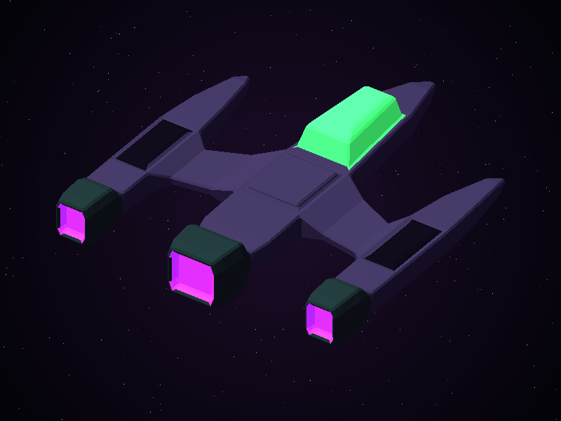
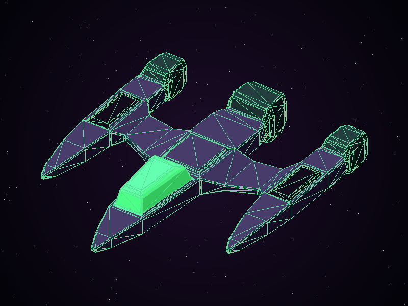

# lab4-graficas

Laboratorio 4: carga el modelo OBJ de la nave creada en el laboratorio 3 y la
dibuja con un rasterizador de triángulos propio, escrito en Rust
(`minifb` para la ventana y `nalgebra-glm` como equivalente de GLM), en 3D.

## Resultado


Vista 3D de tres cuartos de las **1464 caras** de `assets/nave.obj` (734
vértices), con sombreado por cara y z-buffer, en el mismo ángulo que la captura
de Blender del laboratorio 3.

**Paleta de horror cósmico** (`assets/nave.mtl`): casco violeta abisal, paneles
negro del vacío, motores de metal con verdín, una cabina verde enfermizo que
resplandece como un ojo y toberas de un magenta "de otro mundo". Cabina y
toberas tienen emisión (`Ke`), así que brillan aunque no les dé la luz. El
fondo es un degradado del púrpura al negro con estrellas.

| Toberas (vista trasera, `--yaw 325`) | Aristas (`W` o `--edges`) |
| --- | --- |
|  |  |

## Modelo

`assets/nave.obj` es la nave de `lab3-graficas/entrega_referencia/nave.obj`:
las mismas 734 posiciones y 1464 triángulos que la versión sin materiales, pero
con las caras agrupadas en cinco partes (`usemtl`). Solo se renombraron
`mtllib` y los materiales para la nueva paleta.

## Cómo funciona

1. **Carga del OBJ, una sola vez** (`src/obj.rs`): lee el archivo línea por
   línea. Las líneas `v` se guardan en un `Vec<Vec3>` y las `f` en `[usize; 3]`.
   A cada índice se le resta 1 (OBJ empieza en 1) y se valida que esté dentro
   del vector. `mtllib` carga el MTL (`newmtl`, `Kd`, `Ke`) y `usemtl` asigna
   el material a las caras siguientes; las demás líneas se ignoran. El centro del modelo
   y la lista de aristas también se calculan antes del bucle principal.
2. **Rotación** (`to_view_space()` en `src/main.rs`): cada vértice se traslada
   al centro del modelo y se rota con matrices de `nalgebra-glm`: giro sobre Y
   (yaw) e inclinación sobre X (pitch). La vista inicial es yaw 145°, pitch 35°.
3. **Proyección y encuadre** (`to_screen_space()`): proyección ortográfica de
   las posiciones ya rotadas. Se toman sus límites, se centra y se escala con
   `min(0.8 * ancho_pantalla / ancho, 0.8 * alto_pantalla / alto)` (se comprueba
   que ambos sean mayores que cero). Z se conserva como profundidad.
4. **Recorrido manual de caras** (`render()`): para cada cara se toman sus tres
   vértices, se calcula su normal y una iluminación difusa (Lambert); el color
   es `Kd × (ambiente + luz × Lambert) + Ke` de su material. Luego se llama a
   `triangle()`.
5. **Rasterizador** (`src/triangle.rs`): rellena un triángulo recorriendo su
   caja envolvente con funciones de arista y la regla top-left, e interpola la
   profundidad con coordenadas baricéntricas para el z-buffer. Los triángulos
   degenerados (área cero en pantalla) se descartan sin dividir entre cero.
   `line()` dibuja las aristas opcionales respetando la profundidad.
6. **Framebuffer y color** (`src/framebuffer.rs`, `src/color.rs`): buffer de
   color y z-buffer, imagen de fondo, `clear()`, `set_current_color()` y
   `point_with_depth()`.
   `src/png.rs` es el escritor PNG propio del laboratorio 1.

En cada cuadro: eventos de la ventana → `clear()` → `render()` →
`update_with_buffer()` para presentar el framebuffer.

## Compilar y ejecutar

Requisitos: Rust (cargo) y, en Linux, las bibliotecas de X11 que usa `minifb`
(en Wayland funciona vía XWayland).

Ejecutar **desde la raíz del repositorio**, porque el modelo se carga desde la
ruta relativa `assets/nave.obj` (si no se encuentra ahí, se busca relativo a la
carpeta del proyecto):

```bash
cargo run --release
```

- Flechas: rotar la nave (izquierda/derecha = yaw, arriba/abajo = pitch).
- `R`: volver a la vista inicial.
- `W`: mostrar u ocultar las aristas.
- `S`: guardar la captura en `screenshots/nave_renderizada.png`.
- `Esc` o cerrar la ventana: salir.

Otras opciones:

```bash
cargo run --release -- ruta/a/otro.obj            # cargar otro OBJ de triángulos
cargo run --release -- --screenshot salida.png    # dibujar un cuadro, guardar PNG y salir
cargo run --release -- --edges                    # empezar con las aristas visibles
cargo run --release -- --yaw 325 --pitch 35       # otro ángulo inicial (grados)
```

## Estructura

```text
lab4-graficas/
├── Cargo.toml
├── assets/
│   ├── nave.obj               # modelo del laboratorio 3, con grupos de material
│   └── nave.mtl               # paleta de horror cósmico
├── screenshots/
│   ├── nave_renderizada.png
│   ├── nave_toberas.png
│   └── nave_aristas.png
└── src/
    ├── main.rs                # ventana, bucle, cámara, proyección y render()
    ├── obj.rs                 # lector OBJ (v / f / usemtl) y MTL
    ├── triangle.rs            # relleno de un triángulo
    ├── framebuffer.rs
    ├── color.rs
    └── png.rs                 # escritor PNG sin dependencias
```
